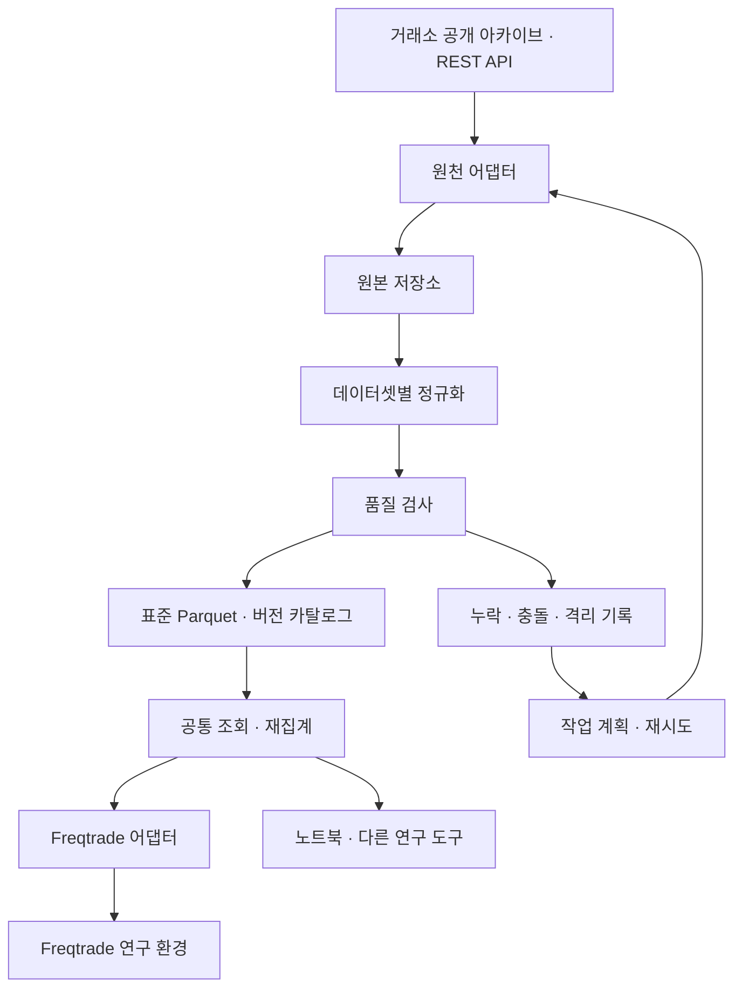

# BTCUSDT 시장 데이터 플랫폼 설계안

작성일: 2026-09-21 · 구현 현황 갱신: 2026-09-22

## 구현 현황과 원설계의 차이

현재 실행 방법은 [README](../README.md), 실제 검증은 [수집·출력 보고서](../reports/baseline/v0.1.0/smoke.json)와
[Freqtrade 로더 검사](../reports/baseline/v0.1.0/freqtrade-loader.json)에 있다. 아래 본문은 원설계를 보존한 것이며,
모든 후속 기능이 이미 구현됐다는 뜻은 아니다.

- 별도 설치 가능한 코어/어댑터, Binance ZIP·REST 수집, 체크섬·품질 검사, Parquet·SQLite,
  불변 revision·스냅샷, 재집계, 누락 조회·복구, CLI를 구현했다.
- 2026-09-14~20 UTC의 현물·선물·마크·지수 분봉, 펀딩, 두 OI 원천을 실제 확보했다.
  Freqtrade 2026.8 공식 Docker에서 11개 파일 로딩과 현물·선물 백테스트를 실행했다.
- 코드 구조는 초기 규모에 맞게 `domain.py`, `binance.py`, `normalize.py`, `store.py`,
  `pipeline.py`, `transforms.py`, `operations.py`, `backfill.py`, `research.py`로 단순화했다.
  조회는 `Store.read(Key, start, end, snapshot_id)`다.
  시간 열 이름은 `timestamp`, 원본 출처는 `source_id`와 `source_row`다.
- OI는 `series=archive/rest`를 키에 추가했다. archive 기준 시각·수량 단위는 미확정 상태로 유지하며
  검증 표본의 5분 차이를 전 기간에 자동 보정하지 않는다. [OI 검토](legacy-oi-review.md)
- REST 격자 자료는 요청당 최대 행 수 이내의 기간으로 나눈다. OI의 긴 요청이 최근 500개만
  반환하는 동작을 실제로 확인하고 수정했다.
- Freqtrade 펀딩 출력에서만 1초 미만 정산 시각 차이를 시간 경계로 내린다.
  원천 시각은 core와 별도 피처 파일에 보존한다. 한 시간 중간의 정산 이벤트는 export에서 거부한다.
- 읽기 경로는 PyArrow이며 DuckDB는 반환된 Arrow 테이블에 SQL을 실행할 때 사용한다.
  카탈로그 테이블은 현재 필요한 artifacts/fetches/jobs/revisions/active/issues/queries/snapshots로 통합했다.
  운영 범위·실행 기록·revision별 완전성 캐시는 sync_targets/sync_runs/sync_coverage에 보존한다.
- 기본 스냅샷은 `historical_assumption`이다. 전체 과거 revision의 시점별 재구성,
  자동 품질 예외 승인과 독립 `reconcile` 명령은 아직 구현하지 않았다.
  일관된 카탈로그·불변 파일의 백업, 검증, 별도 경로 복원과 용량 점검 CLI를 추가했다.
  [백업·복원 범위와 사용법](backup-and-storage.md)
  최근 구간 재확인은 `update`/`repair --refresh`를 사용한다.
- `status`와 운영 범위 내 자동 누락 복구를 구현했다. 중간 누락·장기 중단·중단 후 재시작·
  데이터셋별 실패 격리를 검증했고, 사용자 systemd 타이머 두 개를 활성화해 실제 실행을 확인했다.
  REST OI의 최초 28일 범위도 확보했다. [운영 정책과 확인 방법](operations.md)
- UTC `[2023-09-22, 2026-09-22)`의 과거 수집·원천 재조회·품질 보고서를 완료했다.
  거래봉과 펀딩 조회 범위는 전체를 확보했고, 마크·지수의 미확보 2분과 OI의 누락·격리를
  별도로 보고한다. 입력이 완전한 연속 구간으로 19개 스냅샷을 만들었다.
  [3년 연구 데이터셋 검증](../reports/baseline/research-2023_2026/summary.md)
  BTCUSDT 선물 aggTrade의 짧은 REST 조회와 WebSocket 수집·ID 복구를 추가했다.
  [실시간 이벤트 세그먼트와 검증 범위](aggtrades.md)를 참고한다.
  현물·장기 aggTrades 아카이브, 호가 스트리밍과 실제 전략 연구는 후속 단계다.

## 1. 목적과 경계

BTCUSDT의 공개 시장 데이터를 지속적으로 확보하고, 검증된 동일 데이터를 여러 연구 도구에서 재사용한다. 첫 소비자는 Freqtrade이지만 수집기·공통 스키마·저장소는 Freqtrade에 의존하지 않는다.

초기 운영은 단일 머신의 로컬 디스크와 배치 작업을 기준으로 한다. 종목은 BTCUSDT, 시장은 Binance 현물과 USDT 결제 선형 무기한 선물이다. 초기 과거 수집 목표는 실행 시점 기준 최근 3년이며, 실제 계획에는 고정된 UTC 시작·종료 시각을 기록한다. 원천별 제공 범위가 다르므로 모든 데이터가 같은 기간 존재한다고 가정하지 않는다.

핵심 결정:

- 공통 데이터에는 시장 사실과 출처를 저장한다. 전략 신호·포지션·매매 손익은 소비자에서 계산한다.
- 원본, 검증된 표준 데이터, 재생성 가능한 파생 데이터를 구분한다.
- Freqtrade의 종목 표기·파일 이름·컬럼 규약·설정은 소비자 어댑터에만 둔다.
- 과거 채우기, 일별 갱신, 누락 복구가 같은 수집·검증·게시 경로를 사용한다.
- 반복 실행과 중단 후 재시작이 안전해야 한다. 연구 실행은 데이터 버전을 고정한다.
- 첫 버전은 공개 데이터만 다룬다. 주문 실행·계정 인증·실시간 주문 라우팅은 범위 밖이다.

## 2. 수집 범위

| 데이터셋 | 시장 | 원천 단위 | 도입 | 보관할 핵심 정보 |
|---|---|---|---|---|
| `trade_bars` | 현물·선물 | 1분 | 1차 필수 | OHLC, base/quote 거래량, 체결 건수, taker 매수 base/quote 거래량 |
| `funding_events` | 선물 | 정산 이벤트 | 1차 필수 | 실제 정산 시각·확정 펀딩률·제공되는 정산 마크가격 |
| `mark_price_bars` | 선물 | 1분 | 1차 필수 | 마크가격 OHLC |
| `index_price_bars` | 선물 | 1분 | 1차 확장, 기본 활성화 | 지수가격 OHLC |
| `open_interest` | 선물 | 5분 통계 | 1차 확장, 조기에 활성화 | OI 수량·명목가치·단위·통계 기준 시각 |
| `instrument_metadata` | 현물·선물 | 관측 시점별 | 1차 필수 | 상품 유형, 자산, 수량 단위, 계약 배수, 가격·수량·주문금액 제약 |
| `aggregate_trades` | 현물·선물 | 집계 체결별 | 2차 선택 | 집계 ID·시각·가격·수량·maker 방향·원천 제공 체결 ID 범위 |
| `trades` | 현물·선물 | 개별 체결별 | 개별 체결이 필요한 경우 | 개별 체결 ID와 가격·수량·방향 |
| `book_quotes`, `book_depth` | 현물·선물 | 호가 이벤트 | 3차 선택 | 최우선 호가·잔량 또는 스냅샷·증분·순서 정보 |

필수 데이터와 확장 데이터의 성공 여부는 독립적이다. OI의 긴 과거 이력이 없다는 이유로 3년 캔들 연구를 막지 않는다. OI를 사용하는 연구만 OI가 존재하는 기간을 선택한다.

`aggregate_trades`와 `trades`는 별도 데이터셋이다. 집계 체결을 개별 체결로 복원했다고 표시하지 않는다. 거래소 집계 방식과 그 변경도 원천 어댑터의 버전 정보에 남긴다.

수수료는 초기에는 연구 실행의 가정으로 기록한다. 계정 등급·할인에 따른 실제 수수료 수집은 추후 별도 기능이다. 현재 조회한 상품 규칙이나 수수료를 과거 전체에 적용 가능한 사실로 취급하지 않는다.

## 3. 구조와 의존 방향



| 구성요소 | 책임 | 경계 |
|---|---|---|
| `domain` | 상품 식별, 스키마, 시간·단위·키 정의 | 거래소 SDK·Freqtrade import 없음 |
| `sources/binance` | URL, pagination, 응답 해석, 원천별 제공 범위 | 공통 계약에 맞는 결과를 반환 |
| `pipeline` | 작업 계획, 정규화, 검사, 게시, 복구 | 전략·백테스트 실행을 모름 |
| `storage` / `catalog` | 원본·Parquet·SQLite, 버전·출처·coverage | 특정 소비자의 파일 규칙을 모름 |
| `reader` / `transforms` | 스냅샷 조회, 시간봉 재집계, 일반 데이터 변환 | 소비자별 포맷 변환과 분리 |
| `marketdata_freqtrade` | Freqtrade 출력·추가 지표 로딩·호환성 검사 | 별도 패키지. 공통 조회 계약만 사용, 원천 파일을 직접 읽지 않음 |

같은 저장소에서 개발하되 코어와 Freqtrade 어댑터를 별도 설치 가능한 패키지로 둔다. 코어만 설치한 환경에서 수집·조회·검사가 모두 동작해야 한다. Freqtrade와 그 종속 패키지는 어댑터의 선택적 개발·호환성 검사 환경에만 설치한다.

초기에는 프로세스 간 서비스 API 대신 로컬 라이브러리·파일 계약을 쓴다. 코어의 입력과 출력 계약이 유지되면 추후 저장소나 배포 단위를 분리할 수 있다.

## 4. 원천과 수집 정책

### 4.1 데이터 출처

| 대상 | 과거 확보 | 최근 갱신·복구 |
|---|---|---|
| 거래 캔들 | 공개 월별 파일 우선, 남은 구간은 일별 파일 | 일별 파일, 필요한 누락은 REST |
| 마크·지수 캔들 | 데이터셋별 아카이브 제공 범위를 먼저 확인, 부족하면 REST | 일별 파일 또는 REST |
| 펀딩 이벤트 | 공식 이력 API, 지원되는 아카이브는 제공 여부 확인 후 사용 | 겹치는 기간을 재조회해 정산 건별 병합 |
| OI | 최근 API 범위부터 확보, 과거 metrics 아카이브는 별도 조사 | 5분 통계 API 주기적 조회 |
| 상품 메타데이터 | 최초 조회 당시 상태 저장 | 일별 및 변경 발견 시 새 관측 저장 |

Binance 공개 아카이브는 일별·월별 파일, 체크섬, 과거 파일 수정 이력을 제공한다. 파일별 게시 시각은 고정 시각으로 가정하지 않는다. 현물 공개 파일은 2025-01-01부터 마이크로초 타임스탬프를 사용하므로 원천·기간별 파서 규칙을 둔다. [공식 공개 데이터 설명](https://github.com/binance/binance-public-data)

OI 통계 REST API의 조회 범위는 최근 1개월이다. 이것은 모든 과거 OI 자료가 존재하지 않는다는 뜻은 아니다. metrics 아카이브의 실제 파일 범위·필드·시각 의미는 구현 첫 단계에서 검증한다. 확인 전에는 3년 OI 제공을 약속하지 않는다. [공식 선물 시장 데이터 API](https://developers.binance.com/en/docs/catalog/core-trading-derivatives-trading-usd-s-m-futures/api/rest-api/market-data)

### 4.2 작업 모드

- `backfill`: 요청 기간과 기존 coverage의 차이만 계획한다. HTTP 전송 단위는 월/일 파일 또는 API 페이지이며, 정제 게시 단위와 구분한다.
- `update`: 완료된 구간을 추가한다. 캔들은 최근 3일을 재확인하고, 펀딩·OI는 최근 구간을 겹쳐 조회한다.
- `repair`: 특정 데이터셋·기간의 누락·오류만 재처리한다. 원본이 있으면 다운로드 없이 정규화부터 재실행할 수 있다.
- `reconcile`: 아카이브 수정과 원천 간 차이를 확인한다. 최근 파일을 정기 재확인하고, 긴 과거 구간은 변경 이력 또는 명시적 기간으로 검사한다. 과거 전체를 매번 스캔하지는 않는다.

기본 실행안은 캔들·펀딩·메타데이터의 일별 갱신과 OI의 5분별 갱신이다. OI는 마지막 1시간을 겹쳐 조회하고, 재시작 시 미확보 구간을 API 제공 범위 안에서 복구한다. 게시·응답 지연을 허용하며 실행 간격과 여유 시간은 설정으로 둔다.

REST 요청의 페이지 끝점 포함 여부는 원천 어댑터에서 처리하고, 내부 범위는 항상 `[start, end)`로 통일한다. 페이지 중복을 제거하되 진행되지 않는 응답을 탐지한다. 정상 응답의 빈 목록만으로 구간 완전성을 판정하지 않는다.

호출 제한은 엔드포인트 weight와 공급자 제한을 공유하는 제한기로 관리한다. `429`는 `Retry-After`를 따르고, 연결 오류·일시적 서버 오류에는 상한이 있는 지수 재시도를 적용한다. 잘못된 요청·접근 제한은 별도 오류로 표시한다. 아직 게시되지 않은 파일과 잘못된 경로를 같은 404 정책으로 무한 재시도하지 않는다.

## 5. 공통 데이터 계약

### 5.1 상품 식별

내부 식별 예시:

```text
binance:spot:BTCUSDT
binance:linear_perpetual:BTCUSDT
```

상품 레지스트리에 `exchange`, `market_type`, `exchange_symbol`, `base_asset`, `quote_asset`, `settlement_asset`, `quantity_unit`, `contract_multiplier`를 명시한다. 같은 문자열 BTCUSDT라도 시장이 다르면 다른 상품이다. 지수가격의 원천 식별자가 계약 심볼과 다를 경우 그 매핑도 보존한다.

`BTC/USDT`, `BTC/USDT:USDT` 같은 소비자 표기는 어댑터에서 생성한다. 코어에는 Freqtrade의 `CandleType`이나 설정 파일을 저장 계약으로 사용하지 않는다.

### 5.2 시간과 수치

- 모든 표준 시각은 `timestamp[us, UTC]`. 원본의 시각 값과 단위는 원본·파서 메타데이터로 보존한다.
- 캔들의 `bar_start`는 포함, `bar_end`는 제외다. 원천의 마지막 포함 시각은 이 규칙으로 정규화한다.
- `first_observed_at`은 해당 레코드 버전을 우리 시스템이 처음 확보한 시각이다. 재다운로드해도 과거 관측 시각을 덮어쓰지 않는다.
- `source_published_at`은 원천에서 검증 가능한 공개 시각이 있을 때만 기록하며, 모르면 null이다.
- 초기 BTCUSDT 가격·수량·금액·비율은 Arrow `decimal128(38,18)`을 기본 계약으로 검증한다. 수용 범위를 넘는 입력은 조용히 반올림하지 않고 오류 처리한다. 원본은 남는다.
- 건수는 정수, 비율은 소수 비율로 저장한다. 소비자가 필요로 하는 float 변환은 내보내기 시 수행한다.

### 5.3 데이터셋별 필드와 키

모든 레코드는 `instrument_id`, `provenance_id`, `first_observed_at`, nullable `source_published_at`을 가진다. 스키마 버전은 파일·카탈로그에 기록한다. `provenance_id`는 원본 아티팩트·원천 레코드 위치·변환 버전을 추적하는 출처 정보와 연결한다.

| 데이터셋 | 주요 필드 | 자연키: 동일 스냅샷 안에서 유일 |
|---|---|---|
| `trade_bars` | interval, bar_start, bar_end, OHLC, base_volume, quote_volume, trade_count, taker_buy_base_volume, taker_buy_quote_volume | 상품 + interval + bar_start |
| `mark_price_bars`, `index_price_bars` | interval, bar_start, bar_end, OHLC | 데이터셋 + 상품 + interval + bar_start |
| `funding_events` | settlement_time, funding_rate, event_type, settlement_mark_price nullable | 상품 + settlement_time + event_type |
| `open_interest` | observation_time, source_period, quantity, notional_value, quantity_unit, value_currency | 상품 + source_period + observation_time |
| `instrument_metadata` | observed_at, source_effective_at nullable, 거래 규칙·상품 속성 | 상품 + observed_at |

OI의 시각이 통계 구간 시작인지 끝인지 원천 계약에서 확정한다. 최신 OI 스냅샷 API와 5분 통계 API를 동일 시계열로 섞지 않는다. OI 명목가치도 가격으로 추정한 값과 원천이 제공한 값을 구분한다.

마크·지수 캔들에 존재하지 않는 거래량을 공통 저장소에서 0으로 만들어 넣지 않는다. 펀딩은 정산 이벤트 그대로 보관한다. Freqtrade의 호환 스키마는 어댑터가 만드는 별도 출력이다.

## 6. 저장과 재현성

### 6.1 기본 구성

- Python: 수집·검증·CLI. 의존 버전은 구현 시 lockfile로 고정한다.
- PyArrow + Parquet: 표준 스키마와 압축 저장.
- SQLite: 단일 머신의 작업 상태·출처·coverage·버전 카탈로그. 쓰기는 조정 프로세스 하나로 직렬화한다.
- DuckDB: 읽기·기간 조회·연구용 SQL. Decimal 계산에서 의도하지 않은 float 변환을 검사한다.
- OS 스케줄러: 배치 CLI 호출. 같은 작업의 중복 실행을 잠금으로 방지한다.

### 6.2 디스크 배치

```text
data/
  raw/binance/<source>/<dataset>/<instrument>/<source-name>/<sha256>/payload
  canonical/<dataset>/schema=v1/instrument=<id>/interval=<value>/date=YYYY-MM-DD/revision=<hash>.parquet
  derived/<transform>/<version>/...
  snapshots/<snapshot-id>.json
  exports/<consumer>/<export-id>/...
state/
  catalog.sqlite
reports/
  <run-id>.json
```

경로는 규칙을 설명하는 예시다. 이벤트 데이터에는 interval 디렉터리를 생략한다. 실제 파일 이름에는 경로에 안전한 식별자를 사용한다. 펀딩과 OI는 일별 파일이 지나치게 작으면 월별로 묶되, 시간 구간별 coverage는 별도로 유지한다.

원본은 다운로드한 ZIP 또는 응답 JSON을 그대로 보관한다. URL·요청 조건·응답 시각·제공 체크섬·직접 계산한 해시를 카탈로그에 기록한다. 같은 URL의 내용이 바뀌면 새 해시의 원본을 추가한다.

표준 파일도 게시 후 수정하지 않는다. 수정본은 새 revision으로 쓰고 카탈로그에서 활성 버전을 바꾼다. 연구 스냅샷은 정확한 파일 목록·해시·스키마·변환 버전·품질 상태를 참조하므로, 이후 수정본이 나와도 기존 실험은 같은 입력을 읽는다.

reader는 활성 버전 또는 지정 스냅샷의 파일 목록만 읽는다. 모든 revision을 glob으로 읽어 중복 행을 만드는 접근은 허용하지 않는다. 초기에는 재현성을 위해 원본과 revision을 자동 삭제하지 않는다. 용량 정리는 참조 중인 스냅샷을 보호하는 별도 명령으로 도입한다.

일반 연구 스냅샷은 선택한 데이터셋들의 활성 revision을 하나의 일관된 카탈로그 조회에서 확정한다. 과거 관측 시점까지 재현하는 `observed` 모드는 필요한 과거 revision 이력도 스냅샷에 포함한다. 스냅샷 생성 중 갱신된 파일이 일부만 섞이지 않게 한다.

### 6.3 카탈로그의 논리 테이블

| 테이블 | 주요 내용 |
|---|---|
| `instruments` | 상품 식별·원천 심볼 매핑 |
| `artifacts` / `fetches` | 원본 해시·파일·수집 요청 이력 |
| `jobs` / `attempts` | 작업 범위·재시도·진행·오류 |
| `partitions` / `revisions` | 게시 파일·행 수·시간 범위·스키마·활성 버전 |
| `provenance` | 원본 레코드 위치 또는 입력 revision·변환 버전 |
| `coverage` / `quality_issues` | 구간별 완전성·누락·충돌·제공 불가 사유 |
| `snapshots` / `snapshot_members` | 연구 입력 파일의 고정 목록 |
| `exports` | 소비자 버전·입력 스냅샷·출력 해시·호환성 검사 결과 |

coverage와 작업 상태는 분리한다. 다운로드 성공, 파싱 성공, 완전한 기간 확보, 소비자 출력 성공은 서로 다른 사실이다. 이벤트 데이터는 조회 완료 범위와 예상 이벤트 검증 수준을 함께 기록하며, 단순 행 수로 완전성을 표시하지 않는다.

## 7. 품질 검사와 중단 복구

### 7.1 게시 전 검사

- 아카이브 체크섬, 파일 파싱, 스키마·시간 단위·자료형 검증.
- 자연키 중복, 시간 정렬, 요청 범위를 벗어난 값 확인.
- 거래 캔들의 `low <= open/close <= high`, 양수 가격, 음수가 아닌 거래량·건수 검사.
- 원천 의미가 일치하는 경우 taker 매수량이 전체 거래량을 초과하는지 검사.
- 캔들 격자와 누락 확인. 거래가 존재해야 하는 전체 UTC 하루의 1분봉은 1,440개가 기준이지만, 상장 시작·공식 중단 구간은 별도 상태로 표시한다.
- 펀딩의 음수 값은 정상일 수 있다. 8시간 고정 간격이나 무조건 일정한 건수를 강제하지 않는다.
- OI는 음수가 아닌지와 원천 통계 시각·격자를 검사한다. 비정상적으로 큰 변화는 경고하며 시장 이벤트를 임의 삭제하지 않는다.

현재 진행 중인 봉은 완료 데이터로 게시하지 않는다. 필수 검사가 실패한 구간은 격리하고 기존 검증본을 유지한다. 누락 캔들을 이전 가격과 거래량 0으로 생성하지 않는다. 공식 원천의 실제 거래량 0인 캔들과 수집 실패는 구분한다.

캔들만 완전하더라도 펀딩이 불완전한 선물 연구를 정상이라고 표시하지 않는다. 스냅샷 생성 시 소비자가 선언한 필수 데이터셋의 구간과 준비 기간을 각각 검사한다.

### 7.2 충돌과 수정

같은 자연키·같은 값은 하나로 합치고 추가 출처를 기록한다. 월별·일별 파일의 겹침도 같은 규칙이다.

같은 키의 값이 다르면 무조건 마지막 값으로 덮어쓰지 않는다. 다른 원천 간 충돌은 기록·재조회 후 비교한다. 해결되지 않은 구간의 새 게시를 중지한다. 동일 공식 파일의 수정은 새 원본·revision으로 처리하고, 검증 후 정책 버전과 변경 내역을 남겨 활성화한다. 기존 스냅샷은 유지한다.

파서나 스키마 변경도 새 버전을 만든다. 재집계 결과는 입력 revision 목록을 가지며, 입력이 바뀌면 영향을 받는 결과와 소비자 출력을 새 버전으로 생성한다.

### 7.3 원자적 게시

1. 임시 위치로 다운로드하고 체크섬 확인 후 원본을 확정한다.
2. 원본에서 표준 데이터를 생성하고 품질 검사를 수행한다.
3. 같은 파일시스템의 임시 Parquet을 완성·동기화한 뒤 고유 revision 경로로 rename한다.
4. SQLite 트랜잭션에서 revision·출처·coverage·활성 버전·작업 완료를 함께 기록한다.
5. reader는 커밋된 카탈로그만 조회한다.

파일 기록과 DB 커밋은 하나의 트랜잭션이 아니므로, 중간 종료 시 DB에 없는 파일이 남을 수 있다. 재시작은 원본과 해시를 기준으로 검증을 재실행해 동일 결과로 수렴한다. DB가 참조하지 않는 파일은 자동으로 정상 데이터로 간주하지 않는다. DB가 가리키는 파일의 누락·해시 불일치도 시작 시 및 정기 검사에서 탐지한다.

정규화 작업의 중복 판정에는 원본 해시·데이터셋·대상 구간·파서 버전·스키마 버전·검증 정책 버전을 사용한다. 과거에 같은 날짜를 성공했다는 이유만으로 수정된 원본의 재처리를 건너뛰지 않는다. 변경 없는 재수집은 기존 레코드 버전의 관측 시각을 유지한다.

상태 예시: `pending -> running -> raw_saved -> validated -> published`. 일시 장애는 `retry_wait`, 미게시 자료는 `waiting_source`, 데이터 오류는 `quarantined`, 복구 불가능하게 확인된 구간은 별도 coverage의 `unavailable`로 기록한다. 만료된 실행 잠금은 재시작 시 회수한다.

## 8. 조회·재집계와 시점 일관성

### 8.1 공통 조회 계약

아래는 구현할 인터페이스의 개념이며 현재 실행 가능한 API는 아니다.

```text
read_bars(instrument_id, dataset, interval, start, end, snapshot_id)
read_funding_events(instrument_id, start, end, snapshot_id)
read_open_interest(instrument_id, source_period, start, end, snapshot_id)
coverage(instrument_id, dataset, start, end)
create_snapshot(required_datasets, start, end, quality_policy)
```

캔들 조회 범위는 `bar_start`, 이벤트 조회는 해당 이벤트·관측 시각 기준의 `[start, end)`다. 결과는 데이터와 함께 해석 가능한 스키마·단위·품질·출처 정보를 제공한다. 대화형 조회에서 최신 버전을 선택해도 실제 해석된 스냅샷 ID를 반환한다. 연구·내보내기는 고정 ID를 사용한다.

### 8.2 재집계

- 1분 거래 캔들에서 5분·15분·1시간·4시간·1일 캔들을 생성한다. 초기 기본 출력은 1분·5분·15분·1시간이다.
- UTC 경계의 `[start, end)`에서 시가는 첫 값, 고가는 최대, 저가는 최소, 종가는 마지막, 거래량·거래대금·체결 수·taker 매수량은 합계다.
- 필요한 하위 봉이 모두 완전한 구간만 완전한 상위 봉으로 게시한다.
- 마크·지수는 가격만 집계한다. 펀딩 이벤트를 일반 OHLCV로 재집계하지 않는다.
- OI는 잔고 성격의 관측값이므로 합산하지 않는다. 마지막 관측 선택·변화량 계산은 명시된 파생 규칙으로 수행한다.
- 일반 재집계와 전략별 RSI·임계값·학습 피처는 분리한다. 전략별 계산은 소비자 영역이다.

### 8.3 미래 정보 사용 방지

`event_time`, 봉 종료 시각, 원천 공개 시각, 우리 수집 시각은 서로 다른 의미다. 오늘 다운로드한 2023년 자료의 수집 시각을 2023년 공개 시각으로 바꾸지 않는다. 반대로 그 자료를 2023년 연구에 쓸 수 없다고 단정하지도 않는다.

연구는 다음 두 모드 중 하나를 명시한다.

- `observed`: 실제 당시 저장한 관측 시각 이후의 값만 사용한다. 관측 전 구간은 이 모드로 평가할 수 없다.
- `historical_assumption`: 과거 자료에 봉 종료·이벤트 기준 시각과 명시적 지연 가정을 적용한다. 정확한 과거 공개 시각과 수정 전 값이 불명확할 수 있음을 데이터셋 보고서에 남긴다.

`observed` 모드는 자연키별 버전 이력에서 해당 의사결정 시각까지 관측한 가장 최근 버전을 선택한다. 최신 수정본의 행을 시간으로 필터링하는 것만으로 구현하지 않는다. 초기 과거 연구의 기본 모드는 `historical_assumption`이며, 관측 이력 조회가 구현·검증되기 전에는 `observed` 모드를 지원한다고 표시하지 않는다.

소비자의 지표 결합은 의사결정 시각 이전에 이용 가능했던 최신 값만 선택한다. OI의 결측을 미래 값으로 채우지 않으며, 값이 너무 오래됐는지 판단하는 허용 나이도 연구 설정에 둔다. 확정 펀딩비를 정산 전 예측값처럼 사용하지 않는다. 비용 정산에 쓰는 이벤트와 진입 판단에 쓰는 과거 펀딩 피처를 구분한다.

## 9. Freqtrade 소비자 어댑터

어댑터 입력은 공통 reader와 스냅샷이고, 출력은 별도 `exports/freqtrade/<export-id>`다. Freqtrade가 출력 파일을 변경해도 원본과 표준 저장소는 영향을 받지 않는다.

어댑터가 담당할 작업:

1. 상품을 현물 `BTC/USDT`, 선물 `BTC/USDT:USDT`로 매핑한다.
2. 필요한 전략 시간봉을 공통 transforms에서 얻는다. 마크가격·펀딩은 대상 Freqtrade 버전의 거래소 어댑터가 기대하는 주기와 파일 규칙에 맞춘다.
3. UTC 시각과 수치를 대상 버전의 컬럼·dtype으로 변환하고 Feather를 기본 출력으로 생성한다.
4. 거래대금·taker 매수량·OI 등 추가 필드는 별도 피처 파일과 로더로 제공한다. 일반 OHLCV 컬럼에 억지로 넣지 않는다.
5. 대상 버전, 출력 규약 버전, 스냅샷, 준비 기간, 출력 파일 해시, 추가 지표의 시각 정책을 export manifest에 기록한다.
6. Freqtrade의 실제 데이터 로더와 최소 백테스트로 읽기·기간·행 수·정산 호환성을 검사한다.

확인한 현재 공식 규약은 일반 캔들에 `date, open, high, low, close, volume`, 펀딩에 `date, funding_rate`를 사용한다. 과거 버전과 펀딩 스키마가 다를 수 있으므로 사용자가 사용할 정확한 릴리스 또는 커밋에 어댑터를 고정한다. `stable` 브랜치 주소 자체는 버전 잠금으로 쓰지 않는다. [공식 컬럼 정의](https://github.com/freqtrade/freqtrade/blob/stable/freqtrade/candle_columns.py)

Freqtrade는 선물 다운로드에서 필요한 마크·펀딩 데이터를 함께 수집하고, 파일 형식과 데이터 유형을 규정한다. 그 기능은 비교용 표본과 호환성 검사에 활용하며, 코어 수집 파이프라인의 의존성으로 넣지 않는다. `convert-data`도 임의의 공통 저장소를 이해하는 범용 변환기로 가정하지 않는다. [데이터 다운로드 문서](https://www.freqtrade.io/en/stable/data-download/)

Freqtrade의 Orderflow는 별도 확장 어댑터로 다룬다. 집계 체결을 입력으로 쓸 경우 개별 체결 수와 같은 지표 의미가 달라지는지 검증한다. 과거 호가에서 피처를 만들 수 있어도 Freqtrade 기본 백테스트가 호가 큐·슬리피지·부분 체결을 재현한다고 주장하지 않는다. [Orderflow](https://docs.freqtrade.io/en/stable/advanced-orderflow/), [호가 조회의 백테스트 제한](https://docs.freqtrade.io/en/stable/strategy-customization/#orderbookpair-maximum)

Freqtrade가 누락을 채우거나 불완전한 마지막 봉을 제거하는 과정에서 입력이 바뀔 수 있으므로, 원본 export와 실제 로드 결과를 비교한다. 누락 있는 기간은 기본적으로 연구용 export에서 거부하고, 사용 가능한 기간으로 좁히거나 별도 명시한 정책으로만 진행한다.

## 10. 패키지·CLI와 운영

제안하는 코드 구조:

```text
packages/
  marketdata/
    pyproject.toml
    src/marketdata/
      domain/
      sources/binance/
      pipeline/
      storage/
      catalog/
      reader/
      transforms/
      cli.py
  marketdata_freqtrade/
    pyproject.toml
    src/marketdata_freqtrade/
      export.py
      features.py
      compatibility.py
configs/
docs/
tests/
```

CLI는 `marketdata plan/backfill/update/repair/validate/coverage/snapshot`, 소비자 측 CLI는 `marketdata-freqtrade export/check`로 제안한다. 코어 설정에는 상품·데이터셋·기간·저장 위치·재시도·스케줄을 둔다. Freqtrade 버전·종목 표기·전략의 준비 기간은 소비자 설정에 둔다.

향후 호가 수집은 별도의 스트리밍 실행기로 추가한다. 원천 스냅샷과 증분 이벤트, 순서 식별자, 거래소 시각과 수신 시각을 저장하고, 순서가 끊기면 새 스냅샷으로 재동기화하며 단절 구간을 기록한다. 그 사이의 호가를 복원했다고 표시하지 않는다.

각 실행은 run ID, 처리 행 수, 취득 바이트 수, 최종 완전 구간, 누락, 재시도, 429 응답, 미해결 충돌을 JSON 보고서와 구조화 로그에 남긴다. 데이터셋별 갱신 지연을 표시하고, 일별 아카이브와 5분 OI에 서로 다른 지연 기준을 적용한다.

백업 대상은 원본·참조 중인 표준 revision·snapshot manifest와 SQLite의 일관된 백업이다. SQLite는 백업 API 등 일관성을 보장하는 방법으로 복사한다. 복구 시 파일 해시와 카탈로그 참조를 대조한다.

용량은 최초 7일분을 실측해 연 단위로 추정한다. 평년의 1분 가격 시계열 하나는 약 52.6만 행이고, 현물·선물·마크·지수의 4개 시계열을 3년 모으면 약 630만 행이다. 압축률과 revision 수는 아직 측정하지 않았으므로 고정된 필요 GB 수를 제시하지 않는다.

## 11. 구현 순서와 완료 조건

| 단계 | 구현 대상 | 완료 조건 |
|---|---|---|
| 0. 원천과 표본 확인 | 데이터별 제공 범위·단위·시각 확인, 짧은 기간의 원본 | 표본·스키마·실제 이용 가능 기간을 기록 |
| 1. 코어의 처음부터 끝까지 연결 | 현물·선물 1분봉, 원본, 검증, Parquet, 카탈로그, reader | 7일분 수집을 반복해도 동일 결과. 중간 종료 후 복구 가능 |
| 2. 선물 보조 데이터와 정기 수집 | 펀딩·마크·지수·OI·상품 메타데이터, 일별·5분 스케줄 | 누락과 미게시 자료를 구분하고 중단된 작업을 재개 가능 |
| 3. 연구 데이터 제공 | 재집계·스냅샷·coverage·수정 이력 | 원본 수정 후에도 이전 snapshot으로 같은 입력 재조회 가능 |
| 4. Freqtrade 연동 | 독립 exporter·추가 지표 로더·버전 고정 | 대상 버전에서 현물·선물 로딩과 짧은 백테스트 성공 |
| 5. 선택적 확장 | aggTrades, 필요할 경우 개별 체결·호가 | 대상 전략의 요구와 용량 측정을 바탕으로 추가 |

단계 2에서는 과거 일괄 수집이 끝나기 전에도 OI를 지속적으로 저장할 수 있게 한다. 3년분으로의 확대는 짧은 기간의 전체 흐름을 검증한 뒤 진행한다.

구현 시 중점 검증 항목:

- 2024/2025년 현물 자료의 시각 단위 경계를 올바르게 처리한다.
- 월별·일별·REST 중복을 제거하고 값이 다른 레코드는 충돌로 탐지한다.
- 다운로드 도중·Parquet 확정 후·DB 커밋 전후에 종료돼도 안전하게 재실행한다.
- 1분봉 누락이 상위 시간봉에서 가려지거나 의도하지 않은 보간으로 채워지지 않는다.
- 음수 펀딩률과 변경되는 정산 간격을 올바르게 보관한다.
- 과거 OI의 제공 범위 부족을 정상적인 빈 데이터로 처리하지 않는다.
- 미래의 OI와 확정 펀딩비가 과거 시점의 판단에 섞이지 않는다.
- 데이터 수정 전후의 관측 이력을 조회할 때 각 시점에 알 수 있었던 버전이 선택된다.
- Freqtrade 미설치 환경에서 코어의 수집·검증·조회가 동작한다.
- 대상 Freqtrade 버전의 로더로 출력 컬럼·기간·실제 로딩 결과를 대조한다.

## 12. 구현 첫 단계에서 확인할 사항

다음은 단계 0의 조사 항목이다.

- 대상 Freqtrade의 정확한 버전과 해당 버전의 마크·펀딩 파일 규칙 및 기대 주기.
- Binance 아카이브의 실제 제공 범위, OI metrics의 컬럼·관측 시각, 공개 지연 처리.
- 실행 머신의 디스크와 중단 후 재시작 가능한 스케줄러.
- 초기 3년의 정확한 시작일, 이용 가능 기간, 백테스트 전 준비 기간.

시장 데이터의 의미·품질·출처·재현성과 소비자 사이의 경계를 공통 계약으로 유지한다. Freqtrade에서 바뀌는 규칙은 Freqtrade 어댑터 안에서 반영한다.
