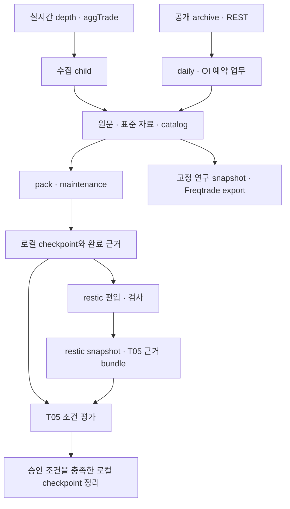

# 프로젝트 구조와 실제 운영 코드

**운영 서비스는 `/opt/marketdata/releases/`의 고정 실행본을 사용한다.**
`/home/yoonhc/projects/algoTrade/historical_data`는 개발 저장소이면서 운영 데이터·상태·보고서를 보관하는 경로다.
작업 폴더의 코드를 수정하거나 Git에 커밋해도 운영 실행본에 자동 반영되지 않는다.

이 안내는 **2026-10-25 20:40–20:46 KST**에 조회한 실효 `systemctl show`의
`ExecStart`·`ExecStartPre`·`User`·`FragmentPath`, 설치된 진입점과 설정 경로를 기준으로 한다.
수집 supervisor는 계속 실행되고, 예약 업무는 timer가 요청할 때 실행되는 별도 프로세스다.
아래의 ‘운영 코드’는 상시 실행 중인 프로세스와 다음 예약에 사용할 코드를 함께 뜻한다.
업무별 완료·보류·품질 상태는 [운영 안내](system-runtime-operations.md)와 [TODO](../TODO.md)에서 구분한다.

## 1. 호스트에서의 배치

| 위치 | 역할 |
|---|---|
| `/opt/marketdata/releases/` | 검증·고정한 운영 코드와 Python 환경. 여러 실행본을 함께 사용 |
| `/etc/systemd/system/marketdata-*` | 실제 시스템 service·timer. 사용할 Python, 진입점, 사용자와 보호 옵션 지정 |
| `/etc/marketdata/` | 수집·부팅·예약 업무·T05의 실제 설정과 승인 문서 |
| `/home/yoonhc/.config/marketdata/` | restic·네트워크 관측 등의 실제 프로필. 자격 증명은 소스와 구분 |
| `/home/yoonhc/projects/algoTrade/historical_data/` | 개발 소스, 고정 후보·검증 기록, 운영 시장 데이터·원장·출력 |
| `/var/lib/marketdata-clock/` | 부팅 ledger와 배포·전환·승인·복구 기록 |
| `/var/lib/marketdata-checkpoint-retirement/` | T05의 계획·run·journal·근거 등 정리 상태 |
| `/mnt/backup/` | 로컬 checkpoint, restic 저장소, 별도 복원 작업 공간 |

`WorkingDirectory`나 데이터 경로가 프로젝트 폴더라고 해서 그 폴더의 Python 소스를 실행하는 것은 아니다.
실제 실행본은 유닛의 `ExecStart`와 wrapper의 import 경로를 함께 확인해야 한다.

## 2. 현재 사용하는 고정 실행본

아래 표의 이름은 모두 `/opt/marketdata/releases/` 아래 디렉터리다.
이후 설명에서는 긴 경로를 반복하지 않도록 C·S·A·R·B·M으로 표시한다.

| 표기 | 실행본 이름 | 현재 역할 |
|---|---|---|
| C | `clock-evidence-policy-20261009-65296619a374c325` | depth·aggTrade 수집 supervisor, child 수집과 시각 근거 |
| S | `scheduled-clock-policy-20261016-686bb70c9ee4ef11` | 8개 예약 업무의 T16 기반 코드·Python 환경. restic 소스는 A 사용 |
| A | `restic-output-20261022-585c3e3686704e5c` | T18 출력 공유를 포함한 restic wrapper·보관 소스 |
| R | `t05-recurring-retirement-20261018-e57a7995f03fb301` | T05 로컬 checkpoint 정리 |
| B | `system-bootstrap-20261007-f85eb8321a19c1ee` | 부팅 준비 Python·기존 clock gate |
| M | `scheduled-manager-20261012-255d64b78ffa8328` | 현재 bootstrap에서 사용하는 시스템 manager 연결 adapter |

S는 업무별로 `base/`, `daily/`, `preserve/` 세 변형을 가진다.
각 변형에는 `packages/marketdata/src/marketdata/`, 필요한 `scripts/`, 고정 `.venv/`가 있다.

**A는 새 소스와 기존 Python 환경을 조합한다.** 실제 restic 서비스는
`S/preserve/.venv/bin/python`으로 `A/policy/run_job.py`를 실행하고, A의 `preserve/` 소스를 import한다.
따라서 S의 preserve 가상환경은 현재도 필수 의존성이다.
M도 bootstrap에서 사용하므로, 디렉터리 날짜가 오래됐다는 이유로 미사용 실행본으로 판단하면 안 된다.

### 실시간 수집

두 시스템 유닛은 `marketdata-collector@depth.service`와 `marketdata-collector@aggtrade.service`다.
`C/.venv/bin/python -I`로 다음 코드를 실행한다.

| 파일 | 역할 |
|---|---|
| `C/integrations/runtime/capture_runtime.py` | 지속 supervisor, child 수명 관리, 실행 중 시각 감시·근거 연결 |
| `C/integrations/runtime/marketdata_runtime.py` | 프로필·시각 평가, child 명령 구성 등 runtime 공통 처리 |
| `C/integrations/runtime/clock_gate.py` | 시작 전 bootstrap·시각 준비 확인 |
| C의 설치 패키지 `marketdata/cli.py` | child의 `depth-stream`·`aggtrade-stream` 진입점 |
| 같은 패키지의 `depth_stream.py`, `aggtrade_stream.py` | 실제 연결·수신·저장 처리 |
| 같은 패키지의 `depth.py`, `depth_refresh.py`, `aggtrades.py` | 호가 재생·복구, 체결 자료 처리 |
| 같은 패키지의 `clock_evidence.py` | 시각 관측 근거와 chunk 게시 연결 |

child는 같은 고정 Python에서 `marketdata.cli.main()`을 호출하며, 기본 수명은 3,600초다.
C의 업무 모듈은 `.venv/lib/python3.12/site-packages/marketdata/`에 설치돼 있다.
시작 전 검사·supervisor·실제 수집 child는 서로 다른 역할이다.

### 8개 예약 업무

공통 경로는 **system timer → service → `policy/run_job.py` → 업무 진입점**이다.
서비스는 `User=yoonhc`로 실행되며, wrapper는 선택한 변형의 소스 디렉터리를 import 경로 앞에 넣는다.
따라서 이 경로에서는 가상환경 이름만 보고 실제 `marketdata` 코드 위치를 판단하면 안 된다.

| 시스템 service | 소스 / Python 환경 | wrapper가 호출하는 업무 코드 |
|---|---|---|
| `marketdata-oi.service` | S / `base` | `marketdata.cli` → `operations.py` 등의 OI REST 갱신 |
| `marketdata-oi-probe.service` | S / `base` | `marketdata.cli` → `oi_probe.py` |
| `marketdata-oi-quality.service` | S / `base` | `marketdata.cli` → `oi_quality.py` |
| `marketdata-daily.service` | S / `daily` | `marketdata.daily_schedule` → 일별 공개 자료 처리·재시도 원장 |
| `marketdata-pack.service` | S / `base` | `marketdata.cli` → `maintenance.py`·`packing.py` |
| `marketdata-backup.service` | S / `preserve` | `scripts/checkpoint_evidence.py` → checkpoint 생성·T05 완료 근거 |
| `marketdata-restic-archive.service` | A / S의 `preserve` | `scripts/restic_schedule.py` → `archive_backups.py` → `archive_output.py` |
| `marketdata-network-observer.service` | S / `base` | `scripts/network_observer.py` |

공통 wrapper 주변에서 먼저 읽을 파일은 다음 세 가지다.

| 파일 | 담당하는 일 |
|---|---|
| `policy/run_job.py` | 업무 선택, 요청 잠금·정체성, 재개, 업무 결과와 감시 종료 기록 |
| `<variant>/packages/marketdata/src/marketdata/job_clock.py` | 업무별 시각 구간 판단, 관측·감시, 시각 대기와 실행 장애 구분 |
| `policy/request_contract.py` | 코드·설정 식별 입력, 저장 근거 검증, 업무별 요청 종결 판정 |

`policy/job_clock.py`에도 고정한 모듈 사본이 있으며, 실제 업무 import는 선택한 변형 안의 파일을 사용한다.
별도 `marketdata-jobs-clock-ready.service`는 S의 wrapper를 `--wait`로 호출한다.

T18에서 고친 `archive_output.py`는 **이번 restic dump를 실제로 읽고 해시가 일치한 뒤**
성공한 manifest 본문을 공유한다. 조회·검증 자체는 `archive_backups.py`에 남아 있다.
`restic_schedule.py`는 예약 출처·진행 상태·결과를 연결하고, `run_job.py`는 그 결과를 요청 기록으로 확정한다.

### T05와 부팅 준비

T05 시스템 service의 진입점은 `R/scripts/run_clock_retirement.py`다.
이 파일이 R의 소스 경로를 선택하고 `scripts.clock_retirement.main()`을 호출한다.

| 파일 | 역할 |
|---|---|
| `R/scripts/clock_retirement.py` | 미리보기·수동 적용·반복 실행, 승인·시각·근거·미완료 상태 검사 |
| `R/scripts/retire_checkpoints.py` | inventory·유지 사본·잠금·staging·삭제 journal을 포함한 정리 처리 |
| `R/scripts/retirement_clock.py` | 정리 판단에 필요한 시각 연결 |
| R의 `marketdata/checkpoint_evidence.py`, `checkpoint_clock.py`, `checkpoint_locks.py` | 완료·순서 근거, 관측·binding, checkpoint 잠금 |

대상은 `/mnt/backup/marketdata-historical/automatic`의 승인 조건을 충족한 로컬 checkpoint다.
운영 원본·카탈로그와 restic snapshot/pack은 이 정리 대상과 구분한다.

현재 bootstrap service는 `B/.venv/bin/python`으로 `M/migration/bootstrap_system.py`를 실행한다.
이 adapter는 `pinned.py`가 확인하는 기존 clock gate를 불러와 시스템 manager의 실행 구성을 연결한다.
기존 `marketdata-clock-ready.service`와 T16의 `marketdata-jobs-clock-ready.service`도 서로 다른 진입점이다.

## 3. 개발 저장소의 디렉터리

```text
historical_data/
├── packages/
│   ├── marketdata/src/marketdata/       # 수집·정규화·저장·품질·보존 코어
│   └── marketdata_freqtrade/src/       # 연구 데이터 소비·내보내기 어댑터
├── scripts/                           # restic, 유지보수·진단·연구 실행 도구
├── configs/                           # 개발/수집 범위 설정과 예시
├── integrations/                      # systemd 템플릿, Freqtrade/Docker 연결
├── tests/                             # 개발 소스의 검사
├── docs/                              # 설계·사용법·운영 안내·milestones
├── reports/
│   ├── baseline/                      # 고정 후보 소스·계획·검증·배포·복구 근거
│   └── restic-archive-runs/            # 운영 명령 receipt·출력·공유 본문
├── data/                              # 운영 원문·표준 자료·pack·연구 출력
├── state/                             # SQLite 원장·요청·시각 근거·잠금·현재 상태
├── archive-state/                     # restic 편입·검사 상태와 저장소 잠금
├── backups/・restore-checks/           # 기존 로컬/시험 산출물; 현재 정기 보관 경로와 구분
├── pyproject.toml・uv.lock             # Python workspace와 의존성 고정
├── README.md                          # 프로젝트 입구와 기본 사용법
└── TODO.md                            # 남은 개발·운영 관찰·조건부 후속
```

루트 `.venv/`는 개발 환경이다. `configs/`와 `integrations/systemd/`도 현재 설치 설정과 동일하다고
가정하지 않는다. 특히 기존 사용자 유닛 템플릿과 실제 시스템 유닛은 구분해야 한다.
실효 설정은 `/etc/systemd/system/`, `/etc/marketdata/`, 해당 사용자 프로필에서 확인한다.

### 코어 파일을 역할별로 읽기

아래 파일은 [개발 코어](../packages/marketdata/src/marketdata/) 기준이다.
특정 운영 동작을 검토할 때는 위 표에서 선택한 고정 실행본의 대응 파일을 읽는다.

| 묶음 | 주요 파일 | 역할 |
|---|---|---|
| 명령·공통 규칙 | `cli.py`, `domain.py`, `schema.py` | CLI, 자료 식별·오류·시각/해시 표현, 표준 행 구조 |
| 다운로드·변환 | `binance.py`, `normalize.py`, `pipeline.py` | 원천 요청, REST/아카이브 파싱·검증, 게시 연결 |
| 범위·갱신 | `operations.py`, `backfill.py` | 갱신 대상·coverage·과거 자료 확보 |
| 저장·조회 | `store.py`, `fileio.py` | SQLite catalog, 원문·Parquet revision·publication·snapshot, pack 읽기 |
| 실시간 체결·호가 | `aggtrade_stream.py`, `aggtrades.py`, `depth_stream.py`, `depth.py`, `depth_refresh.py`, `stream_guard.py` | 연결·복구·저장·재생·수집 보호 |
| OI 관측·비교 | `oi_probe.py`, `oi_quality.py` | REST 관측과 archive/REST 품질 비교 |
| 보존 | `maintenance.py`, `packing.py`, `backup.py`, `checkpoint_locks.py` | 파일 묶기, checkpoint 생성·검증, 잠금 |
| 연구 | `research.py`, `transforms.py` | 연구 입력과 파생 결과 |

[Freqtrade 어댑터](../packages/marketdata_freqtrade/src/marketdata_freqtrade/)의
`cli.py`, `export.py`, `features.py`, `window.py`는 고정 데이터 snapshot을 소비한다.
수집 코어가 Freqtrade를 실행하거나 의존하는 구조는 아니다.

## 4. 자료와 실행 기록의 흐름



| 경로 | 담기는 내용 |
|---|---|
| `data/raw/` | 내려받거나 수신한 원문 |
| `data/canonical/` | 표준화한 자료와 revision |
| `data/packs/` | 묶은 파일과 원래 기록의 연결 |
| `data/snapshots/`, `data/exports/` | 고정 연구 자료와 소비자용 출력 |
| `state/catalog.sqlite` | 자료·조회·revision·게시·수집·업무 원장 |
| `state/scheduled-clock-policy/<job>/` | request, 고정 날짜·pins, attempt와 시각 판단 기록 |
| `state/runtime-clock/` | 실시간 수집의 시각 관측 기록 |
| `state/*-latest.json` | 현재 상태 표시용 보조 보고서. 과거 완료 근거와 구분 |
| `archive-state/` | 저장소·scope별 편입 상태, 검사 결과와 archive 잠금 |
| `reports/restic-archive-runs/` | 실행별 receipt·stdout/stderr, `manifest-objects-v1/` 공유 본문 |
| `/mnt/backup/marketdata-historical/automatic/` | 현재 정기 로컬 checkpoint |
| `/mnt/backup/marketdata-historical/.automatic.retiring/` | T05 이동·정리 중 staging |
| `/mnt/backup/marketdata-restic/` | 실제 restic 저장소 |
| `/mnt/backup/marketdata-restic-restore/` | 별도 복원 작업 공간 |

이 세 가지 snapshot은 구분한다. `data/snapshots/`는 연구용 고정 자료,
checkpoint는 로컬 복구 사본, restic snapshot은 저장소 안의 보존 지점이다.
`reports/` 역시 일반 로그만 있는 폴더가 아니다. 요청 복구와 T05가 참조하는 근거,
고정 소스·승인·실패 기록까지 있으므로 디렉터리 이름만으로 보관 수명을 판단하지 않는다.

## 5. 최신 구현 소스를 저장소에서 찾는 위치

**10/25 개발 소스 통합으로 최신 업무 구현을 루트에서 읽고 수정할 수 있다.**
위 1–4절의 실제 `/opt` 배포 구성은 그대로이며, 루트 통합본의 운영 배포는 별도다.
[통합 출처·검증·한계](../reports/baseline/source-integration-2026-10-25/summary.md)를 함께 확인한다.

| 관심 코드 | 현재 개발 기준 |
|---|---|
| 수집 supervisor·부팅·시스템 inventory | [integrations/runtime](../integrations/runtime/) |
| 수집 시각 근거 | [clock_evidence.py](../packages/marketdata/src/marketdata/clock_evidence.py) |
| T13 daily | [daily_schedule.py](../packages/marketdata/src/marketdata/daily_schedule.py), 같은 패키지의 `daily_probe.py`·`daily_preview.py`·`daily_review.py` |
| T16 업무 진입점 | [scripts/run_job.py](../scripts/run_job.py) |
| T16 시각·복구 계약 | [job_clock.py](../packages/marketdata/src/marketdata/job_clock.py), [request_contract.py](../packages/marketdata/src/marketdata/request_contract.py) |
| T05 완료·정리 | [checkpoint_evidence.py](../packages/marketdata/src/marketdata/checkpoint_evidence.py), [scripts/clock_retirement.py](../scripts/clock_retirement.py)와 관련 도구 |
| T18 restic·출력 공유 | [archive_backups.py](../scripts/archive_backups.py), [archive_output.py](../scripts/archive_output.py), [restic_schedule.py](../scripts/restic_schedule.py) |
| 8개 시스템 업무의 유닛 출력 | [render_scheduled_units.py](../scripts/render_scheduled_units.py), [매개변수 템플릿](../integrations/systemd/scheduled/) |

루트 wrapper는 세 변형 대신 동일한 `packages/marketdata/src/`와 `scripts/`를 선택한다.
요청 identity에는 공통 업무 소스와 의존성 선언도 포함해 같은 개발 경로 안의 코드 변경을 구분한다.
기존 운영 request의 identity를 바꾸거나 자동 이전하는 기능은 추가하지 않았다.

[최종 재검토](../reports/baseline/source-integration-2026-10-25/final-review.md)에서
연결 검사 16개·생성 유닛 구문 검사 21개와 최종 소스/구성 해시를 확인했다.
다음 배포에서는 예약 업무가 읽는 루트 소스와 수집기가 읽는 설치 패키지의 일치를 검증해야 한다.
기존 `integrations/runtime/seal_runtime.py`는 수집용 설치 패키지·runtime만 고정하므로
통합본 전체 실행 파일의 manifest를 대신하지 않는다.
검사의 날짜별 보고서 의존 분리와 요청 identity 범위 정리는
[TODO의 조건부 개선 항목](../TODO.md)에 남겨 두었다.

현재 배포본과 과거 실행의 재현·감사에는 아래 고정 소스를 계속 사용한다.

| 관심 코드 | 저장소의 고정 소스·연결 |
|---|---|
| 현재 수집 runtime | [collector-correction/release](../reports/baseline/clock-runtime-transition-2026-10-09/collector-correction/release/) |
| T16 최종 수정본 | [scheduled-clock-result-fix/candidate](../reports/baseline/scheduled-clock-result-fix-2026-10-16/candidate/) — `policy/`, `base/`, `daily/`, `preserve/` |
| 현재 restic 출력 공유 실행본 | [t18-archive-deploy/runtime](../reports/baseline/t18-archive-deploy-2026-10-22/runtime/) — `policy/`, `preserve/` |
| T05 반복 정리 실행본 | [source.tar.gz](../reports/baseline/t05-recurring-candidate-2026-10-18/source.tar.gz), [manifest](../reports/baseline/t05-recurring-candidate-2026-10-18/manifest.json), [patch](../reports/baseline/t05-recurring-candidate-2026-10-18/candidate.patch) |
| 현재 배포·중지·원복 도구 | [T18 도구 연결 문서](../reports/baseline/t18-archive-deploy-2026-10-25/stop-rollback-tools.md) |
| 완료 범위·남은 과제 | [10/25 마일스톤](milestones/2026-10-25-retirement-and-archive-capacity-recovery.md), [TODO](../TODO.md) |

이번 구조 대조에서는 수집 `capture_runtime.py`, T16 `run_job.py`·`request_contract.py`,
T18 `archive_output.py`의 위 보관본과 `/opt` 설치 파일 SHA-256이 같은 것도 확인했다.
전체 실행본의 모든 파일을 새로 검증한 결과로 확대하지 않는다.

코드를 읽을 때는 **실제 유닛의 진입점 → wrapper가 선택한 소스 → 업무 본문 → 저장 원장·결과 계약**
순서가 빠르다. 개발 코어의 기본 구조는 `cli.py`·`store.py`에서 시작하고,
개발 시에는 위 루트 경로에서 예약·복구·보관·정리를 이어서 읽는다. 특정 운영 사건을 대조할 때는
당시 실행본의 대응 파일을 확인한다. 고정 소스와 운영 설치본은 그대로 보존한다.

### 루트 소스는 얼마나 최신인가?

다음은 **통합 전** 10/25의 파일 대조 결과다. 기존 코어와 일부 최신 수정이 있는 루트에
수집 시각 근거·T13·T16·T05의 남은 변경을 합쳤다.

| 범위 | 통합 전 루트와 고정본의 관계 |
|---|---|
| 기존 코어 | 루트의 `marketdata` Python 파일 25개 중 C와 21개, S의 base와 17개가 동일. 전체가 오래됐다고 볼 수 없음 |
| 수집 시각 근거 | `clock_evidence.py`는 루트에 없음. C의 `cli.py`, `aggtrades.py`, `depth.py`, `store.py`도 루트와 다름 |
| T13 daily | `daily_schedule.py`, `daily_preview.py`, `daily_probe.py`, `daily_review.py`가 루트에 없음 |
| T16 | `job_clock.py`와 공통 `policy/`가 루트에 없음. 업무 본문의 시각 판단·결과 연결 변경도 고정 변형에 남음 |
| T05 | `checkpoint_clock.py`, `checkpoint_evidence.py`, 정리·근거 wrapper 등이 루트에 없음. 기존 backup·maintenance·정리 도구도 일부 다름 |
| T18 출력 공유 | 루트 `scripts/archive_output.py`는 A의 운영 소스와 동일. 루트 `archive_backups.py`에도 공유 호출은 있으나, A에 있는 T05 bundle 검증·receipt 연결은 빠져 있음 |

통합은 한 실행본을 통째로 선택하지 않고 공통 기준과 기능별 변경을 대조했다.
예를 들어 S/A의 소스 트리에는 C의 `clock_evidence.py`가 없으며, T05 전용 실행본에는 T16의
`job_clock.py`가 없다. 파일 이름이나 실행본 날짜만으로 선택할 수 없는 이유다.

기존 고정 소스·승인·실패 근거는 유지하고, 루트 소스의 import·기능 연결을 격리 검사한다.
현재 `/opt` 실행본의 변경·서비스 전환은 이 소스 정리와 별도 단계다.
